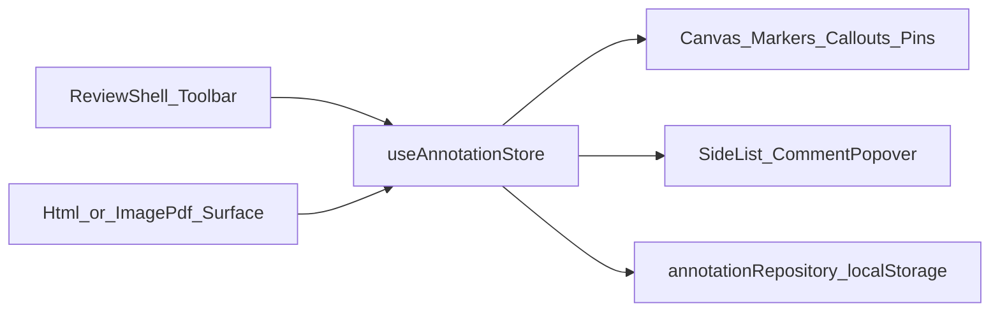

# 作业批阅批注模块 · 前端面试精读文档

> 对照本目录源码阅读。目标：每个功能点都能讲清「业务场景 → 交互 → 数据 → 调用链 → 易错点 → 追问答法」。  
> 不编造未实现能力。`pin` 为兼容/压测能力，工具栏已由图章 `stamp` 替代。

---

## 目录

0. [总览](#0-总览)
1. [公共底座](#1-公共底座)
2. [功能点分章](#2-功能点分章)
3. [选中 / 删除 / 侧栏联动](#3-选中--删除--侧栏联动)
4. [保存 / 导出 / 回显](#4-保存--导出--回显)
5. [面试总复习](#5-面试总复习)

---

## 0. 总览

### 0.1 入口链路

```
/homework-review
  → src/router/index.ts（懒加载 HomeworkReviewPage）
  → src/views/HomeworkReviewPage.vue
  → components/ReviewShell.vue（工具栏 + 侧栏 + Surface 切换）
```

- **HTML 载体**：`components/surfaces/HtmlRichSurface.vue`
- **图片 / PDF 载体**：`components/surfaces/ImagePdfSurface.vue`（PDF 用 `pdfjs` 渲第一页）

### 0.2 架构图



一句话：**工具栏改工具 → Surface 采集指针事件 → Store 写入 Annotation → 分层渲染 + 侧栏编辑 → Repository 持久化。**

### 0.3 公共概念表

| 概念 | 含义 | 面试一句话 |
|------|------|------------|
| `AnnotationKind` | `pin \| stamp \| textbox \| callout \| stroke \| underline \| highlight` | 判别联合，用 `kind` 分支 |
| `ReviewTool` | `select \| stamp \| textbox \| callout \| highlight \| underline \| pen` | 工具与 kind 不完全一一对应（`pen`→`stroke`） |
| `SurfaceMode` | `image \| pdf \| html` | 载体不同，交互与坐标策略不同 |
| 归一化坐标 | `x,y ∈ [0,1]` 相对舞台/页 | 缩放后不漂，适合图片 PDF |
| `HtmlAnchor` | `{ start, end, quote }` 文本偏移 | 划词锚点，重算矩形，适合 HTML |
| `shallowRef(annotations)` | 列表整体替换，不做深响应 | 大批注时减开销 |
| 分层渲染 | Canvas 笔画；DOM 可点批注；SVG 引线；mark-layer 划词 | 按交互形态拆，不全塞进 Canvas |

### 0.4 分层渲染职责

| 层 | 文件 | 画什么 |
|----|------|--------|
| 笔画 / 旧 pin 圆点 | `components/layers/AnnotationCanvas.vue` | `stroke`、`pin`（canvas 圆） |
| 钉按钮 | `AnnotationPins.vue` | 可点击的 pin DOM |
| 图章 / 短文本 | `AnnotationMarkers.vue` | stamp、textbox |
| 引注 | `AnnotationCallouts.vue` | SVG 线+箭头 + 长文本框 |
| 高亮 / 下划线 | Surface 内 `mark-layer` | `getClientRects` 铺出的矩形 |

---

## 1. 公共底座

每个小节固定四块：**做什么 → 关键代码逐步 → 易错点 → 面试怎么说**。

---

### 1.1 `types.ts` — 数据契约

**做什么**  
定义所有批注的 TypeScript 形状、工具枚举、预设文案。这是整个模块的「协议层」。

**关键代码逐步**

1. `AnnotationKind` / `ReviewTool` / `SurfaceMode` / `StampSymbol` 枚举业务空间。
2. `AnnotationBase`：公共字段 `id, kind, surface, pageIndex?, comment?, color?, createdAt`。
3. 各具体类型用 `kind` 字面量收窄：
   - `StampAnnotation`：`symbol` + `x,y`
   - `TextboxAnnotation`：`text` + `x,y`
   - `CalloutAnnotation`：`tipX/Y` + `boxX/Y` + `text` + 可选 `boxWidth`
   - `StrokeAnnotation`：`points[]`
   - `UnderlineAnnotation` / `HighlightAnnotation`：强制 `surface: 'html'` + `htmlAnchor`
4. `Annotation` = 以上联合类型。
5. `AnnotationDraft`：持久化包：`homeworkId` + `contentHash` + `annotations` + `updatedAt`。
6. `CalloutDraftTip`：引注半截态的临时点。

**易错点**

- 工具栏没有「落钉」不代表类型里没有 `pin`——压测与旧草稿仍可能出现。
- `highlight`/`underline` 类型上就锁死 HTML，image/pdf 工具栏会 disable。

**面试怎么说**

> 我用判别联合把批注协议定死：扩展新类型主要是加 `kind` 分支，而不是到处 if-else 散落魔法字符串。

---

### 1.2 `useAnnotationStore.ts` — 状态中枢

**做什么**  
模块级单例状态（闭包 + `ref`/`shallowRef`）：工具、载体、选中、批注列表、引注草稿、侧栏聚焦信号；提供 `add*` / 更新 / 删除 / 序列化。

**关键代码逐步**

1. `annotations = shallowRef<Annotation[]>([])`：新增/修改一律 `annotations.value = [...新数组]`。
2. 按 kind 的 `computed` 过滤器：`pins/stamps/textboxes/callouts/strokes/underlines/highlights`。
3. `setSurface`：切载体、清选中、取消引注草稿；非 HTML 时若当前是高亮/下划线则退回 `select`。
4. `setTool`：切工具时若不是 `callout` 则 `cancelCalloutDraft()`。
5. 引注草稿三件套：
   - `beginCallout(tip)`：记下 tip，preview 同步
   - `updateCalloutPreview(point)`：鼠标移动更新虚线终点
   - `finishCallout(box, partial)`：读 tip → `addCallout` → 清草稿
6. 每个 `add*`：生成 `uid`、补默认色/空评论、`selectedId = 新 id`，多数会 `requestCommentFocus()`（`focusCommentToken++`）。
7. `updateComment` / `updateTextbox` / `updateCalloutText`（callout 截断 200 字）。
8. `serialize` → `AnnotationDraft`；`hydrate` 回灌并清草稿。
9. `generateStressPins(2000)`：批量造 `pin`，用来验证空间索引。

**易错点**

- Store 不是 Pinia，是「模块级状态 + `useAnnotationStore()` 工厂」；多处调用共享同一份状态。
- `shallowRef` 下若直接 `push` 而不换数组引用，视图可能不更新——本项目用整体替换规避。

**面试怎么说**

> Surface 只负责采集事件，不存业务真相；所有写入走 Store，HTML 和图片两套 UI 不会状态分叉，也方便导出同一份 JSON。

---

### 1.3 `annotationRepository.ts` — 持久化边界

**做什么**  
用 `localStorage` 存/读草稿，把「怎么存」和「UI 怎么画」隔开。

**关键代码逐步**

1. key：`homework-review:${homeworkId}`。
2. `saveDraft`：写入 JSON，刷新 `updatedAt`。
3. `loadDraft`：`JSON.parse`，校验 `annotations` 为数组，失败返回 `null`。
4. Demo 常量：`DEMO_HOMEWORK_ID`、`DEMO_CONTENT_HASH`（内容指纹占位，生产可用来判断答卷是否变了）。

**易错点**

- 当前没有版本迁移；旧草稿若缺新字段，渲染侧要容忍缺省（多数靠 Store `add*` 默认值，hydrate 原始数据则靠可选字段）。
- `async` 接口是为了以后换成 HTTP 时签名不变。

**面试怎么说**

> Repository 先落地 localStorage，但 Draft 契约按可换后端设计；`contentHash` 预留「答卷内容变了批注可能失效」的校验点。

---

### 1.4 `htmlRange.ts` — HTML 文本锚点

**做什么**  
在 HTML 答卷上把「屏幕点 / DOM Range」和「全文字符偏移」互相转换，并算相对舞台的位置。

**关键代码逐步**

1. **`textNodes(root)`**  
   `TreeWalker(SHOW_TEXT)` 收集所有文本节点，得到「线性字符流」的物理载体。

2. **`offsetToRange(root, start, end)`**  
   - 遍历文本节点，累加 `cursor`  
   - 当 `cursor + len >= start` 定起点节点与节点内 offset  
   - 同理定终点 → `document.createRange()`  
   - 用于：已知锚点，重算高亮/下划线矩形、HTML pin 位置。

3. **`rangeToOffsets(root, range)`**  
   - 反方向：Range → `{ start, end, quote }`  
   - `quote` 取前 40 字，侧栏展示用  
   - 用于：创建 underline/highlight 时落库。

4. **`caretOffsetFromPoint(root, clientX, clientY)`**  
   - Chrome：`caretRangeFromPoint`  
   - Firefox：`caretPositionFromPoint`  
   - 校验点在 `root` 内，再映射成全文 offset  
   - 用于：按住拖选高亮/下划线时，把指针变成字符位置。

5. **`stageRelativeFromClientRect(stage, rect)`**  
   - 客户端矩形 → 相对 stage 的 `left/top/width/height`  
   - 同时给出中心点归一化 `x,y`（供 pin 等）  
   - 高度分母用 `max(scrollHeight, clientHeight)`，避免长文滚动后比例错。

**易错点**

- 若答卷 DOM 被改写（插入节点、改文案），旧 offset 可能对不上——生产要用 `contentHash` 或更稳锚点（如段落 id + 相对偏移）。
- `caretRangeFromPoint` 在空白处可能返回 null，拖选要容忍。

**面试怎么说**

> HTML 划词不存像素。存文本偏移，展示时用 Range 重算 `getClientRects`。滚动、换行后仍能对准原句。

---

### 1.5 空间索引：`useSpatialIndex.ts` + `spatialIndex.worker.ts`

**做什么**  
大量 `pin` 时，不把几千个 DOM 全挂上；Worker 里建网格索引，主线程只渲染视口内（及选中）的 id。

**关键代码逐步（主线程）**

1. `new Worker(...?worker)`，监听 `ready` / `queryResult`。
2. `watch(pins)` → `rebuild()`：把带 `x,y` 的 pin 发给 Worker，`cellSize: 0.05`。
3. `queryViewport(rect, limit)`：带 `requestId` 的 Promise 映射。
4. `syncVisible(rect, selectedId, limit)`：查询结果 + 强制加入 `selectedId` → `visibleIds`。
5. 卸载 `terminate()`。

**关键代码逐步（Worker）**

1. **`rebuild`**：清空 `pointMap` 与 `grid`；每个点落入 `floor(x/cellSize):floor(y/cellSize)` 桶。
2. **`query`**：遍历 rect 覆盖的格子，精确过滤点是否在 rect 内，达到 `limit` 提前返回。
3. **`hitTest`**（已实现，Surface 未强依赖）：半径内最近点，供将来点选优化。

**易错点**

- Demo 里 `syncVisible` 常查整页 `{0,0,1,1}`，主要演示「限制条数 + Worker」；真滚动虚拟化还要接真实视口。
- 目前索引主要服务 **pin**；stamp/callout 未走同一裁剪（数量通常远小于压测钉）。

**面试怎么说**

> 压测两千钉时，空间查询放 Worker，主线程只挂可见 DOM，保证滚动和书写跟手。网格索引够 Demo；生产可换 R-tree。

---

### 1.6 `CommentPopover.vue` — 侧栏编辑

**做什么**  
根据选中批注的 `kind` 展示标题、引用原文、输入框（短句 / 长文 / 普通评论）、预设短语；监听 `focusToken` 自动聚焦。

**关键代码逐步**

1. `title` / `placeholder` 按 kind 分支（stamp 强调错因；callout/highlight 强调改进意见）。
2. `quote`：仅 highlight/underline 显示 `htmlAnchor.quote`。
3. textbox → `update:text`（最多 40）；callout → `update:text`（最多 200）；其它 → `update:comment`。
4. `TEXTBOX_PRESETS` 一键填入（stamp/textbox）。
5. `watch([focusToken, annotation.id])` → `textarea.focus()`。

**易错点**

- ReviewShell 里 `@update:text` 要再按 kind 分流到 `updateCalloutText` 或 `updateTextbox`。
- `v-if` / `v-else-if` 多个 textarea 共用逻辑 `ref`，同时只存在一个，没问题。

**面试怎么说**

> 创建批注后通过 token 触发侧栏聚焦，强迫「划了就要写意见」，避免只有记号没有反馈。

---

## 2. 功能点分章

每章模板：定位 → 操作 → 数据 → 调用链 → 函数逐步 → 载体差异 → 易错点 → 面试话术。

---

### 2.1 落钉 `pin`

#### 1) 一句话定位

早期「点一下留个蓝钉再写评论」的能力；**工具栏已隐藏**，保留类型与压测入口「生成 2000 钉」。产品路径上由 **图章 stamp** 替代。

#### 2) 用户操作步骤（现状）

1. 点「生成 2000 钉」→ Store `generateStressPins`。  
2. 或加载旧草稿里带 `kind:'pin'` 的数据。  
3. 钉层可点击选中，侧栏改 `comment`。

（历史交互：image/pdf 单击落钉；HTML 划选文字后落钉并带 `htmlAnchor`——当前工具栏无 `pin` 工具，代码里 `addPin` 仍在。）

#### 3) 数据结构

| 字段 | 说明 |
|------|------|
| `kind: 'pin'` | |
| `x?, y?` | 归一化；HTML 常作 layout 缓存 |
| `htmlAnchor?` | HTML 时绑定文本范围 |
| `comment` | 侧栏意见 |

#### 4) 调用链

```
generateStressPins / addPin
  → annotations 追加
  → AnnotationPins（DOM，受 visibleIds 裁剪）
  → AnnotationCanvas.drawPin（canvas 圆点，image/pdf 页注解里可能含 pin）
```

#### 5) 关键函数逐步

- **`addPin`**（Store）：默认蓝色，选中新钉。  
- **`generateStressPins`**：HTML 用假 `htmlAnchor` + 网格分布；image/pdf 用随机 `x,y`。  
- **`AnnotationPins`**：`visibleIds` ∪ `selectedId` 过滤；`left/top = x*width, y*height`。  
- **`layoutPins`（HtmlRichSurface）**：有 `htmlAnchor` 则 `offsetToRange` → `getBoundingClientRect` → 更新 `x,y`。  
- **`useSpatialIndex.syncVisible`**：限制可见钉数量。

#### 6) 载体差异

| 载体 | 行为 |
|------|------|
| HTML | 位置跟文字锚点重算 |
| image/pdf | 固定归一化坐标；Canvas 也会画圆点 |

#### 7) 易错点 / 取舍

- 面试时主动说清：**产品工具是图章，pin 是性能与兼容路径**，避免被问「工具栏怎么没有落钉」。  
- DOM pin 与 Canvas pin 可能同时存在视觉上的圆点——压测场景可接受。

#### 8) 面试话术

**30 秒：**  
> 落钉是最早的点选批注。我们保留数据模型和空间索引压测，真正面向老师的客观题标记升级成了带符号的图章。

**追问：** 为什么要压测 2000 钉？  
> 验证 Worker 网格索引 + 可见集裁剪，避免主线程挂满 DOM。

---

### 2.2 图章 `stamp`

#### 1) 一句话定位

客观题快速判定：✓ / ✗ / 半对 / ?，可选填短错因。

#### 2) 用户操作步骤

1. 工具栏点某个符号（同时 `setStampSymbol` + `tool='stamp'`）。  
2. 在答卷上单击落下。  
3. 侧栏写错因，或点预设「单位未换算」等。

#### 3) 数据结构

| 字段 | 说明 |
|------|------|
| `kind: 'stamp'` | |
| `symbol` | `correct \| wrong \| half \| uncertain` |
| `x, y` | 归一化落点 |
| `color` | 按符号默认绿/红/橙/蓝 |
| `comment` | 短错因 |

`STAMP_SYMBOL_LABEL`：`✓ ✗ ◐ ?`

#### 4) 调用链

```
Toolbar onStamp
  → pointerdown（Html 或 ImagePdf）
  → store.addStamp({ surface, x, y, symbol })
  → AnnotationMarkers 渲染圆形符号按钮
  → CommentPopover 聚焦
```

#### 5) 关键函数逐步

1. **`setStampSymbol`**：取消引注草稿，切工具为 stamp。  
2. **Surface**：`toNorm(event)` 得 `0~1` 坐标 → `addStamp`。  
3. **`addStamp`**：`stampColor(symbol)`；`requestCommentFocus()`。  
4. **`AnnotationMarkers`**：`left/top` 居中偏移 `-16px`；`title` 用 comment 或符号。

#### 6) 载体差异

HTML / image / pdf **均可**单击落章；HTML 页边有 padding，落点可更靠边界。

#### 7) 易错点 / 取舍

- 图章不强制绑 `htmlAnchor`（实现上可选字段存在于类型，落点路径未写 anchor）——位置跟舞台坐标，不跟文字回流。  
- 与短文本分工：图章表对错，短文本表概念提醒。

#### 8) 面试话术

**30 秒：**  
> 客观题对错分明，图章比手画统一高效；落下后侧栏补一句错因，比只打叉更有指导性。

**追问：** 为什么不用笔手画勾叉？  
> 符号标准化、点击一次完成、样式一致，批改吞吐更高。

---

### 2.3 短文本 `textbox`

#### 1) 一句话定位

答卷旁落一条短句（如「公式记错」），偏客观题补充说明。

#### 2) 用户操作步骤

1. 选「短文本」。  
2. 单击落框。  
3. 侧栏编辑最多 40 字，或点预设短语。

#### 3) 数据结构

| 字段 | 说明 |
|------|------|
| `kind: 'textbox'` | |
| `text` | 正文（UI 限 40） |
| `x, y` | 归一化；渲染时框在点上方居中 |

#### 4) 调用链

```
tool=textbox → click → addTextbox → Markers 黄底小气泡 → updateTextbox
```

#### 5) 关键函数逐步

- **`addTextbox`**：默认琥珀色系。  
- **`updateTextbox`**：只改 `kind==='textbox'` 的 `text`。  
- **Markers**：`transform: translate(-50%, -100%)`，单行省略号。  
- **CommentPopover**：`maxlength=40` + 预设。

#### 6) 载体差异

三载体均可；与 callout 对比：短文本无引线、无 tip。

#### 7) 易错点 / 取舍

- `text` 与 `comment` 分离：短文本以 `text` 为准；预设对 stamp 会写 `comment`。  
- 框内展示截断，完整内容靠侧栏。

#### 8) 面试话术

**30 秒：**  
> 反复错的概念用短文本钉在旁边，比单个叉更有教学信息量。

**追问：** 和引注长文本有何区别？  
> 短文本单点、短句；引注是 tip+页边长文+箭头，解决挡原文问题。

---

### 2.4 引注 `callout`

#### 1) 一句话定位

组合工具：箭头指向问题处，长文本框放到页边，适合主观题长反馈。

#### 2) 用户操作步骤

1. 选「引注」。  
2. **第一次单击**：问题位置（tip / 箭头尖）。  
3. 移动鼠标见虚线预览。  
4. **第二次单击**：页边落长文本框。  
5. 侧栏写最多 200 字。  
6. Esc 或切换其它工具：取消半截草稿。

#### 3) 数据结构

| 字段 | 说明 |
|------|------|
| `kind: 'callout'` | |
| `tipX, tipY` | 问题锚点 |
| `boxX, boxY` | 文本框锚点（布局按中心/顶边换算） |
| `text` | 长文 |
| `boxWidth?` | 默认约 200px |

草稿：`calloutDraftTip` + `calloutPreview`（不入 `annotations`，不持久化半截态）。

#### 4) 调用链

```
pointerdown #1 → beginCallout(tip)
pointermove → updateCalloutPreview
pointerdown #2 → finishCallout(box) → addCallout
AnnotationCallouts：SVG 线+三角箭头 + DOM 长框
```

#### 5) 关键函数逐步

1. **`beginCallout` / `finishCallout` / `cancelCalloutDraft`**（Store）。  
2. **Surface `placeCallout`**：无 tip 则 begin，有 tip 则 finish。  
3. **`AnnotationCallouts.layoutOne`**：  
   - 像素化 tip 与 box  
   - 计算线接到框的哪一侧（左/右/上下）  
   - `arrowHead`：在 tip 处画指向 tip 的小三角  
4. 草稿：`draftTip` + `draftPreview` 画虚线。  
5. 页边留白：HTML stage `padding-left/right: 64px`；Image/PDF `GUTTER=64` 扩舞台。

#### 6) 载体差异

三载体都支持两次点击；高亮/下划线仍仅 HTML。

#### 7) 易错点 / 取舍

- 本版**不能拖拽改 tip/box**（面试主动说是范围控制）。  
- 半截草稿不进 JSON；刷新会丢未完成引注。  
- 线是直线，不是折线。

#### 8) 面试话术

**30 秒：**  
> 引注用两步手势把长评放到页边，箭头保住指向，避免大段文字盖住学生原文。

**追问：** 为什么要草稿态？  
> 两次点击必须有中间态；虚线预览降低落框失误，Esc 可取消。

**追问：** 如何扩展拖拽？  
> 选中后对 tip/box 做 pointer drag，更新归一化坐标并重算 `layoutOne`，可加命令栈支持撤销。

---

### 2.5 高亮 `highlight`

#### 1) 一句话定位

主观题：选中写得好或需讨论的句子，铺半透明色块，侧栏写具体意见。

#### 2) 用户操作步骤

1. 载体切到 **HTML**（image/pdf 按钮 disabled 或 toast）。  
2. 选「高亮」。  
3. 在文字上按下拖动，预览色块跟随。  
4. 松开 → 创建 → 侧栏聚焦写意见。

#### 3) 数据结构

| 字段 | 说明 |
|------|------|
| `kind: 'highlight'` | |
| `surface: 'html'` | 类型锁死 |
| `htmlAnchor` | `{ start, end, quote }` |
| `color` | 默认 `#facc15` |
| `comment` | 改进/肯定意见 |

#### 4) 调用链

```
pointerdown → caretOffsetFromPoint → draftStart
pointermove → draftEnd + updatePreview（整行高矩形）
pointerup → finishRangeMark
  → offsetToRange → rangeToOffsets → addHighlight
layoutRangeMarks(mode='highlight') → mark-layer 半透明块
```

#### 5) 关键函数逐步

1. **`onPointerDown`**：仅 `highlight|underline` 开 `drawingRange`，`setPointerCapture`。  
2. **`updatePreview`**：用当前 start/end 算 `getClientRects`，高亮模式画满行高。  
3. **`finishRangeMark`**：`end-start < 1` 丢弃；`addHighlight({ htmlAnchor })`。  
4. **`layoutRangeMarks(..., 'highlight')`**：每个 client rect → 绝对定位 span。  
5. 滚动/resize → `layoutAll` 重算。

#### 6) 载体差异

| 载体 | |
|------|--|
| HTML | 完整支持 |
| image/pdf | 无 OCR，不做划词；工具禁用 |

#### 7) 易错点 / 取舍

- 与早期「HTML 下 pen=下划线」已拆分：pen 现在是自由笔画。  
- 跨多行会有多段 rect，属正常。  
- 空拖（无选中字符）不建批注。

#### 8) 面试话术

**30 秒：**  
> 高亮用文本锚点定位句子，不挡版式；侧栏强制写意见，避免「只涂色不反馈」。

**追问：** 为什么图片卷不能高亮？  
> 没有 OCR 拿不到字符几何；硬做只能矩形涂抹且无法跟文字回流。Demo 诚实降级。

---

### 2.6 下划线 `underline`

#### 1) 一句话定位

主观题标出问题句，底线标记 + 侧栏解释；语义上偏「有问题」，高亮可偏「肯定或关注」。

#### 2) 用户操作步骤

与高亮相同，工具选「下划线」；预览与落库为底线（高度 2px，贴 rect 底部）。

#### 3) 数据结构

同 highlight，但 `kind: 'underline'`，默认色 `#ef4444`。

#### 4) 调用链

同高亮；`finishRangeMark` 分支 `addUnderline`；`layoutRangeMarks(..., 'underline')`。

#### 5) 关键函数逐步

与 2.5 共用拖选状态机；差异仅在：

- 预览/落库颜色与矩形几何（底线 vs 色块）  
- Store `addUnderline`

#### 6) 载体差异

仅 HTML。

#### 7) 易错点 / 取舍

- **面试必提**：下划线工具 ≠ 画笔；画笔是 `stroke` 自由线，用于圈图。  
- 产品上应强调「有下划线就要写 comment」。

#### 8) 面试话术

**30 秒：**  
> 下划线和高亮共用锚点管道，渲染样式不同；和画笔拆开，避免老师以为拖文字是在画画。

**追问：** 如何实现「必须写评语才能保存」？  
> 在 `saveToRepository` 前校验 underline/highlight 的 `comment` 非空，或 UI 标红未填项。

---

### 2.7 画笔 `pen` → `stroke`

#### 1) 一句话定位

自由圈画：几何辅助线、受力分析图等，比纯文字描述更直观。

#### 2) 用户操作步骤

1. 选「画笔」。  
2. 按下拖动采点。  
3. 抬起时若点数 > 1 → `addStroke`。

#### 3) 数据结构

| 字段 | 说明 |
|------|------|
| `kind: 'stroke'` | |
| `points: {x,y}[]` | 归一化折线点 |
| `color` | 默认红 |
| `comment?` | 可选说明 |

#### 4) 调用链

```
pointerdown → draftPoints=[p0], capture
pointermove → append points
pointerup → addStroke({ points })
AnnotationCanvas.drawStroke → lineTo 折线
```

#### 5) 关键函数逐步

1. **ImagePdf / Html** 的 pen 分支：归一化采点。  
2. **`addStroke`**：写入 points，选中该笔画。  
3. **`drawStroke`**：`points` × width/height → `moveTo/lineTo`，`lineCap/Join = round`。  
4. HTML 的 canvas 层 `z-index: 2`，盖在 mark-layer 上。

#### 6) 载体差异

三载体均可；HTML 上可在正文或图示区域圈画。

#### 7) 易错点 / 取舍

- 无笔刷粗细 UI、无橡皮擦（可说后续）。  
- 抬起时点数 ≤ 1 不创建（避免误触）。  
- 草稿点在 pointermove 里频繁换新数组，跟手优先，可再优化。

#### 8) 面试话术

**30 秒：**  
> 画笔走 Canvas 折线，适合图上圈错；跟 HTML 划词工具分离，职责清晰。

**追问：** 为什么笔画用 Canvas，图章用 DOM？  
> 笔画密集、不需逐字编辑；图章要好点选和换符号样式，DOM 更合适。

---

## 3. 选中 / 删除 / 侧栏联动

**做什么**  
`tool=select` 或点击已有标记 → `store.select(id)`；侧栏列表与 Popover 同步；删除整条（callout 锚点+线+框一起删）。

**调用链**

```
Markers/Pins/Callouts @select → store.select
ReviewShell 列表 click → store.select
CommentPopover @remove → store.remove
@update:comment / @update:text → update*
```

**易错点**

- 选中态靠 `selectedId`；列表最多显示 80 条（`windowedList`），与空间索引 limit 思路一致。  
- 切载体会 `selectedId=null`。

**面试怎么说**

> 选中态是单一数据源；删除按 id 移除整条 Annotation，复合批注（引注）不会留下孤儿线。

---

## 4. 保存 / 导出 / 回显

**操作**

- **保存**：`saveToRepository` → localStorage  
- **重新加载**：`loadFromRepository` → `hydrate`  
- **复制 / 导出 JSON**：`exportJson`  
- **清空当前载体**：按 `surface` 过滤删除  

**数据形状**

```ts
{
  homeworkId, contentHash, surface?,
  annotations: Annotation[],
  updatedAt
}
```

**易错点**

- 挂载时自动 load 一次草稿。  
- 引注半截草稿不保存。  
- `contentHash` Demo 写死，生产应随答卷内容变化。

**面试怎么说**

> 持久化与渲染解耦；导出 JSON 即可对接后端批注服务，前端契约已经按 Draft 定好。

---

## 5. 面试总复习

### 5.1 推荐口述顺序（约 2 分钟）

1. **场景**：多载体作业批阅，客观快标、主观定位评、图上圈画。  
2. **架构**：Toolbar → Surface 适配 → Store → 分层渲染 → Repository。  
3. **坐标策略**：图片/PDF 归一化；HTML 划词文本锚点。  
4. **深挖一个**：建议深挖 **高亮**（锚点）或 **引注**（两步态）或 **Worker**（性能）。  
5. **边界**：无 OCR、无拖拽改位、无多人协作——Demo 把主路径打通。

### 5.2 高频追问速查表

| 问题 | 标准答要点 |
|------|------------|
| 为何不全用 Canvas？ | 笔画适合 Canvas；可点击编辑、文本框适合 DOM；引线 SVG 方便 |
| 为何 HTML 存 offset？ | 抗滚动/重排；展示时 Range 重算 |
| 归一化坐标？ | `0~1` 相对页，缩放不错位 |
| 为何 shallowRef？ | 大列表整体替换，避免深代理开销 |
| Worker 做什么？ | 网格索引查询，主线程少挂 DOM |
| pin 去哪了？ | 压测/兼容；产品客观题用 stamp |
| 高亮为啥图片不行？ | 无 OCR |
| 引注半截怎么取消？ | Esc / 切工具 → `cancelCalloutDraft` |
| 和低代码编辑器关系？ | 同仓库不同范式：编辑器 schema 搭建；批阅是文档标注交互 |

### 5.3 生产还缺什么（诚实边界）

- 图片/PDF OCR 划词  
- 批注拖拽改位置、调整 callout tip/box  
- 撤销/重做命令栈  
- 多页 PDF + 真视口虚拟列表  
- 后端同步、权限、冲突合并（`contentHash`）  
- 移动端手势与压感  
- 笔刷样式 / 橡皮擦  
- 无障碍与打印导出

### 5.4 简历可用描述（可选粘贴）

**80 字：**  
基于 Vue3 实现多载体作业批阅：图章/短文本/引注/划词高亮/画笔；文本锚点与归一化坐标分流；Canvas/DOM/SVG 分层渲染；shallowRef + Worker 空间索引优化大量标注；Draft 契约可对接后端。

**40 字：**  
多载体批注系统：判别联合数据模型、分层渲染、文本锚点与 Worker 视口裁剪。

---

## 附录：文件索引

| 路径 | 职责 |
|------|------|
| [types.ts](./types.ts) | 协议 |
| [useAnnotationStore.ts](./useAnnotationStore.ts) | 状态 |
| [annotationRepository.ts](./annotationRepository.ts) | 持久化 |
| [htmlRange.ts](./htmlRange.ts) | HTML 锚点 |
| [useSpatialIndex.ts](./useSpatialIndex.ts) | Worker 封装 |
| [workers/spatialIndex.worker.ts](./workers/spatialIndex.worker.ts) | 网格索引 |
| [components/ReviewShell.vue](./components/ReviewShell.vue) | 壳 |
| [components/surfaces/HtmlRichSurface.vue](./components/surfaces/HtmlRichSurface.vue) | HTML |
| [components/surfaces/ImagePdfSurface.vue](./components/surfaces/ImagePdfSurface.vue) | 图/PDF |
| [components/layers/AnnotationCanvas.vue](./components/layers/AnnotationCanvas.vue) | 笔画 |
| [components/layers/AnnotationPins.vue](./components/layers/AnnotationPins.vue) | 钉 |
| [components/layers/AnnotationMarkers.vue](./components/layers/AnnotationMarkers.vue) | 图章/短文本 |
| [components/layers/AnnotationCallouts.vue](./components/layers/AnnotationCallouts.vue) | 引注 |
| [components/layers/CommentPopover.vue](./components/layers/CommentPopover.vue) | 侧栏编辑 |

---

*文档与仓库实现同步于批注改造后的 Demo。讲解时打开对应文件，按本文「调用链」走一遍即可。*
