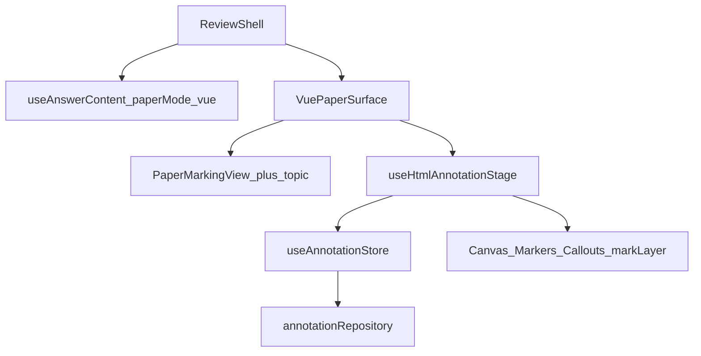

# Vue 试卷批注 · 接手与面试讲解

> 范围：**仅 Vue 试卷模式**（`paperMode === 'vue'`）：组件化答卷 + 其上批注全链路。  
> 目标：读完后能按「业务 → 架构 → 逐功能 → 坐标/拖拽 → 追问」与面试官详聊。  
> 以当前源码为准；不编造未实现能力。更广的多载体总览见同目录 [INTERVIEW.md](./INTERVIEW.md)。

---

## 目录

1. [30 秒开场](#1-30-秒开场)
2. [架构总览](#2-架构总览)
3. [组件化试卷壳](#3-组件化试卷壳)
4. [批注能力逐项](#4-批注能力逐项)
5. [坐标、固定纸宽与命中](#5-坐标固定纸宽与命中)
6. [与 HTML 试卷对比](#6-与-html-试卷对比)
7. [面试追问速查](#7-面试追问速查)
8. [诚实边界与简历短句](#8-诚实边界与简历短句)
9. [附录：文件索引](#9-附录文件索引)

---

## 1. 30 秒开场

**业务一句话**  
老师在「结构化答卷」上批改：打对错图章、写短评、引注长意见、划词高亮、随手画笔；批注可拖改位、侧栏补评论，并落到本地草稿。

**技术一句话**  
同一份试卷 JSON（`sample-paper.json`），用题型 Vue 组件渲染答卷（`PaperMarkingView` + `topic/*`），再在固定宽度的内容框上叠共用批注舞台（`useHtmlAnnotationStage`）：Canvas 画笔、DOM 图章/文本、SVG 引线、划词矩形层。

**入口怎么进 Demo**

```
/homework-review
  → views/HomeworkReviewPage.vue
  → components/ReviewShell.vue
  → 载体选「HTML」+ 试卷模式切「Vue 试卷」
  → components/surfaces/VuePaperSurface.vue
```

注意：工具栏里的「HTML」是 **SurfaceMode**（富文本/答卷类载体，相对图片/PDF），不是「只能用字符串 HTML」。Vue / HTML 试卷是这一载体下的 **两种答卷渲染**。

---

## 2. 架构总览



### 2.1 分层职责

| 层 | 谁 | 干什么 |
|----|----|--------|
| 壳 | `ReviewShell` | 工具栏、侧栏列表、载体/试卷模式切换、保存导出 |
| 答卷数据 | `useAnswerContent` | 持有 `PaperDetail`、`paperMode`；Vue 模式下 `contentHash` = 试卷 JSON 指纹 |
| 试卷 UI | `PaperMarkingView` + `topic/*` | 只读阅卷壳：题型组件 + 题号导航 |
| 批注舞台 | `useHtmlAnnotationStage` | 量测 content-shell、`toNorm`、落点/划词/画笔、布局叠层数据 |
| 状态 | `useAnnotationStore` | `shallowRef(annotations)`、工具态、增删改、序列化 |
| 渲染层 | `AnnotationCanvas` / `Markers` / `Callouts` / Surface 内 `mark-layer` | 按交互形态拆开，不全塞进 Canvas |
| 持久化 | `annotationRepository` | `AnnotationDraft` → localStorage（async 接口便于换 HTTP） |

### 2.2 数据模型（面试必提）

- **判别联合**：`Annotation` 用 `kind` 收窄（`stamp` / `textbox` / `callout` / `stroke` / `underline` / `highlight`…）。
- **工具 ≠ kind**：例如工具 `pen` 写入 `stroke`；工具 `select` 不落新标注，只选中/拖拽。
- **Vue 答卷上标注的 `surface` 字段仍是 `'html'`**：表示「答卷类载体」，与图片/PDF 区分；划词类型在类型层就锁死 `surface: 'html'`。

### 2.3 主链路（口述版）

1. 老师点工具 → `store.setTool` / `setStampSymbol`。  
2. 在 `VuePaperSurface` 的 stage 上指针事件 → `useHtmlAnnotationStage` 的 `onPointerDown/Move/Up`。  
3. 写入 Store（如 `addStamp`、`beginCallout`/`finishCallout`、`addHighlight`）。  
4. watch 触发 `layoutAll` → 各层 props 更新。  
5. 侧栏 / Popover 改 `comment`/`text`；保存走 `serialize` → `saveDraft`。

---

## 3. 组件化试卷壳

### 3.1 为什么要组件化

| 诉求 | 做法 |
|------|------|
| 题型多、要扩展打分/折叠/附件 | 按 `tmlxdm` 注册表挂组件，而不是越写越长的字符串模板 |
| 贴近真实阅卷 | 右侧 sticky 题号导航、得分表、题干/选项/学生作答分区 |
| 批注仍能做 | 试卷挂在 `contentRef` 内，叠层相对 `contentBoxRef`（content-shell） |

**代价（面试要主动说）**  
划词依赖 TreeWalker 扫出的文本序列。组件插槽、条件渲染、额外文案节点会让 `HtmlAnchor` 的 offset 和「肉眼看到的句子」不完全同构；答卷 DOM 大改时要靠 `contentHash` 提示失效。

### 3.2 试卷 JSON → 题型组件

- 类型：[`paperTypes.ts`](./paperTypes.ts)（字段名保持后端拼音缩写：`tmlxdm`、`yjtxxx`、`tmxx`…）。
- Mock：[`mocks/sample-paper.json`](./mocks/sample-paper.json)。
- 注册表：[`quesTypeMap.ts`](./quesTypeMap.ts)

| `tmlxdm` | 题型名 | 组件 |
|----------|--------|------|
| `dxt` | 单选题 | `topic/singalRadio.vue` |
| `duoxt` / `bdxt` | 多选 / 不定项 | `topic/multipleChoice.vue` |
| `pdt` | 判断题 | `topic/determine.vue` |
| `tkt` | 填空题 | `topic/fillVacancy.vue` |
| `jdt` | 简答题 | `topic/shortAnswer.vue` |
| `alt` | 案例题 | `topic/CaseAnalysis.vue`（可含子题） |

未知题型码回退到 `shortAnswer`，避免整页崩掉。

### 3.3 `PaperMarkingView` 结构

文件：[`components/PaperMarkingView.vue`](./components/PaperMarkingView.vue)

1. 标题、考试时长/总分、考生信息。  
2. `el-descriptions` 展示各大题得分。  
3. `v-for` 大题组 → `<component :is="resolveQuesType(...).quesName" :topic-data="..." />`。  
4. 右侧 `exam-nav`：`position: sticky`，点击题号 `scrollIntoView` 到 `#box_${tmid}`。

题型组件当前是 **只读 Demo**（展示题干、选项、对错标记、学生答案等），不在此页改分；批注叠在整张答卷之上，不侵入题型内部状态。

### 3.4 `VuePaperSurface` 如何挂上批注

文件：[`components/surfaces/VuePaperSurface.vue`](./components/surfaces/VuePaperSurface.vue)

```
html-surface（滚动）
  └ stage（固定总宽 = 内容宽 + 左右 gutter）
       └ content-shell（contentBoxRef，固定 980px）
            ├ content（contentRef）→ PaperMarkingView
            └ overlay-root（与 shell 同宽高）
                 ├ mark-layer（高亮/下划线矩形）
                 ├ AnnotationCanvas
                 ├ AnnotationPins
                 ├ AnnotationMarkers
                 └ AnnotationCallouts
```

舞台：`useHtmlAnnotationStage([() => paper.sjid, () => paperMode])`——换卷或切模式后 `nextTick` 再 layout。  
纸宽常量：[`paperLayout.ts`](./paperLayout.ts) 中 `PAPER_CONTENT_WIDTH_WIDE = 980`（Vue 宽版，含题号栏排版）。

---

## 4. 批注能力逐项

每项按：**场景 → 交互 → 数据 → 调用链 → 易错/追问**。

### 4.1 选中与拖拽（`tool === 'select'`）

**场景**  
改位置、点开侧栏编辑，而不是继续落新标记。

**交互**

- 点击图章 / 短文本 / 引注 tip 或长文本框 → `store.select(id)`。  
- 按住拖动（阈值约 3px）→ 写回归一化坐标。  
- 非 `select` 工具：仍可点选，但不进入拖拽。

**数据**  
只改已有标注的 `x,y` / `tipX,tipY` / `boxX,boxY`；拖拽会清掉历史上可能残留的 `htmlAnchor` / `tipHtmlAnchor`（兼容旧草稿）。

**调用链**

- [`AnnotationMarkers.vue`](./components/layers/AnnotationMarkers.vue)：`pointerdown` → window 级 `pointermove/up` → `updateStampPosition` / `updateTextboxPosition`。  
- [`AnnotationCallouts.vue`](./components/layers/AnnotationCallouts.vue)：同上 → `updateCalloutTip` / `updateCalloutBox`。

**易错 / 追问**

- 引注层有一张铺满的 SVG 画线；若 SVG 可命中，会挡住下层图章。当前 `.callout-svg { pointer-events: none }`，tip/box 单独 `auto`。  
- `overlay-root` 为 `pointer-events: none`，可交互子节点 `auto`，避免挡住划词采集。

---

### 4.2 图章 `stamp`

**场景**  
客观题对错、半对、存疑——标准化符号，比手画勾叉更快。

**交互**  
选 ✓/✗/◐/? → 单击答卷落点 → 侧栏可写错因。

**数据**（`StampAnnotation`）

- `symbol`、`x`、`y`（相对 content-shell，`0~1`）  
- `comment`、`color`  
- **落点不再写 `htmlAnchor`**（跟固定纸宽策略一致，钉在试卷坐标上）

**调用链**  
`placeStampOrText` → `store.addStamp({ surface: 'html', x, y, symbol, ... })` → Markers 居中渲染（约 32×32，负 margin）。

**追问**  
为什么不用笔手画？符号统一、一次点击、样式一致，吞吐更高。

---

### 4.3 短文本 `textbox`

**场景**  
概念性提醒（「单位未换算」），比图章多几个字，比引注短。

**交互**  
工具短文本 → 单击落框 → 侧栏/预设改文案。

**数据**  
`text`、`x`、`y`；同样只存试卷坐标，不绑文本锚点。

**调用链**  
同图章分支 → `addTextbox` → Markers 中 `.textbox`（向上平移居中）。

---

### 4.4 引注 `callout`

**场景**  
「问题在这里，意见写在页边」——尖点钉问题，长框写改进意见，线连接。

**交互**

1. 第一次点击：落下 tip（问题位置）。  
2. 第二次点击：落下 box（长文本位置）。  
3. 过程中可预览引线；`Esc` 或切工具 → `cancelCalloutDraft`。  
4. `select` 下可分别拖 tip / box。

**数据**（`CalloutAnnotation`）

- `tipX/tipY`、`boxX/boxY`、`text`、可选 `boxWidth`  
- tip **不再**写 `tipHtmlAnchor`

**调用链**  
`beginCallout(point)` → `updateCalloutPreview` → `finishCallout(box, …)` → Callouts：SVG 线+箭头 + DOM tip/box。

**追问**  
为什么两步？把「指错位置」和「写意见区域」拆开，避免长文本挡住题干。

---

### 4.5 高亮 / 下划线

**场景**  
圈出句子再写评语；必须跟文字走，不能只存一个点。

**交互**  
按下拖选文本范围 → 松手生成标注；多段 `getClientRects` 铺矩形。

**数据**  
强制 `htmlAnchor: { start, end, quote }`；展示时 `offsetToRange` → 相对 content-shell 的像素矩形。

**调用链**  
`caretOffsetFromPoint` 采起止 → `rangeToOffsets` → `addHighlight` / `addUnderline` → `layoutRangeMarks` → `mark-layer`。

**易错**  
Vue 组件 DOM 变化会导致 offset 漂移；生产应结合 `contentHash` 或更稳锚点（段落 id + 相对偏移）。图片/PDF 无 OCR，工具栏禁用划词。

---

### 4.6 画笔 `pen` → `stroke`

**场景**  
自由圈画、强调路径。

**交互**  
按下移动采点，抬起若点数 > 1 则提交。

**数据**  
`points: {x,y}[]`，均为相对 content-shell 的归一化坐标。

**调用链**  
stage 上 capture → `addStroke` → [`AnnotationCanvas.vue`](./components/layers/AnnotationCanvas.vue) 折线绘制（`pointer-events: none`）。

---

### 4.7 侧栏、评论与持久化

**侧栏**  
`ReviewShell` 列出当前 surface 标注（新在上）；点击选中；可删、可清。

**评论**  
`CommentPopover`：按 kind 编辑 `comment` / 短文本 / 引注正文 / 高亮颜色等；落点后 `requestCommentFocus` 促使用户写意见。

**草稿契约**（`AnnotationDraft`）

```ts
{ homeworkId, contentHash, surface?, annotations, updatedAt }
```

- Repository：[`annotationRepository.ts`](./annotationRepository.ts)（localStorage，`async` 便于换后端）。  
- Vue 模式：`contentHash = hash(JSON.stringify(paper))`（见 `useAnswerContent.refreshFromPaper`）。  
- 答卷内容变了 → hash 变 → 可提示旧锚点/批注可能失效（Demo 以回显为主，冲突策略未做全）。

---

## 5. 坐标、固定纸宽与命中

### 5.1 坐标系

- 原点与分母：`content-shell`（`contentBoxRef`），**不含** stage 左右 gutter。  
- 落点 / 拖拽 / 画笔：`toNorm` → `x,y ∈ [0,1]`。  
- 量测：`boxMetrics`（宽用 `clientWidth`，高用 `scrollHeight` 等），与 overlay 的 `width/height` 一致。

**面试一句话**  
归一化相对试卷内容区，不相对带 padding 的外壳，避免窗口变宽时「留白进分母」导致漂移。

### 5.2 固定纸宽策略（当前位置类标注的主方案）

- Vue：内容区锁 `980px`，高度随内容，外层滚动；窄屏横滚，**不挤压换行**。  
- 图章 / 短文本 / 引注 tip：**只存 `x,y`**，绘制直接用存盘坐标。  
- 划词：仍用 `HtmlAnchor` 跟字。

**为何正确**  
容器宽固定 → 同字体同内容下版式稳定 → 试卷相对坐标跨屏可对齐。  
**仍不保证的**：字体/缩放/DOM 结构变化后，纯 xy 不会「粘」在某个字上——那是锚点的职责。

### 5.3 叠层命中

| 规则 | 原因 |
|------|------|
| `.overlay-root { pointer-events: none; z-index: 2 }` | 空白处穿透，方便划词；叠在答卷之上 |
| `.stamp/.textbox/.callout-box/.tip-handle/.pin { pointer-events: auto }` | 可点可拖 |
| `.callout-svg { pointer-events: none }` | 全幅 SVG 默认会抢点击，挡住图章 |

---

## 6. 与 HTML 试卷对比

同一 JSON，工具栏可切换「Vue 试卷 / HTML 试卷」：

| 维度 | Vue 试卷（本模式） | HTML 试卷（对比用） |
|------|--------------------|---------------------|
| 渲染 | `PaperMarkingView` + 题型组件 | `renderPaperToHtml` + `v-html` |
| 产品形态 | 题号导航、分区清晰，易加业务能力 | 接入快，适合后端直出 HTML |
| 批注舞台 | **同一套** `useHtmlAnnotationStage` | 同左 |
| 纸宽 | `980` 宽版 | `794` 标准版 |
| 划词 | 受组件 DOM 文本序列影响更大 | DOM 更扁平时 offset 更直观 |
| `contentHash` | 试卷 JSON 指纹 | 渲染后 HTML 指纹 |

**Demo 结论**：协议与批注栈用 HTML 适配也能跑通；产品化阅卷 UI 更适合 Vue 组件化答卷。

---

## 7. 面试追问速查

| 问题 | 答要点 |
|------|--------|
| Vue 试卷和 HTML 载体是什么关系？ | 载体 `surface=html` 表示答卷类；其下再分 Vue/HTML 两种渲染 |
| 为什么不全用 Canvas？ | 笔画适合 Canvas；可点可拖、可编辑文本适合 DOM；引线 SVG 方便 |
| 坐标为什么用 0~1？ | 相对固定内容框；与像素解耦，纸宽锁定后跨屏稳定 |
| 为什么还要固定纸宽？ | 防止视口变窄换行导致版式变、xy 对不上 |
| 图章为什么不跟字？ | 产品选择钉在试卷坐标；跟字用划词锚点 |
| 划词如何抗滚动？ | 存文本 offset，展示时 Range 重算矩形 |
| 引注为什么两步？ | 尖点指问题，框写长文，空间分离 |
| 拖不动怎么排查？ | 是否在「选中」工具；SVG/叠层是否抢命中；overlay 子节点是否 auto |
| shallowRef 干什么？ | 大列表整体替换，避免深代理 |
| Worker 干什么？ | pin 空间索引/压测裁剪；主线程少算 |
| pin 还在吗？ | 类型与压测仍在；工具栏已由图章替代 |
| 和仓库里低代码编辑器关系？ | 同仓不同范式：编辑器是 schema 搭页面；本模块是文档标注交互 |
| 答卷改了批注怎么办？ | `contentHash` 可校验；生产要冲突策略（Demo 未做全） |
| 如何扩展新题型？ | `quesTypeMap` 注册 + 新 topic 组件，舞台不用改 |
| 持久化如何换后端？ | Repository 已是 async；Draft 契约带 homeworkId/hash/annotations |

---

## 8. 诚实边界与简历短句

### 未做 / Demo 边界

- 撤销/重做命令栈  
- 后端同步、权限、多人冲突合并  
- 划词改选区（非拖色块）、笔画整体平移  
- 题型内联打分写回、附件、折叠的完整产品流  
- 更稳的文本锚点（段落 id 等）  
- 移动端手势与无障碍专项  

### 简历可粘贴

**80 字**  
基于 Vue3 做组件化答卷批阅：题型注册表渲染试卷，固定内容宽 + 归一化坐标叠图章/引注/划词/画笔；Canvas/DOM/SVG 分层；划词用文本锚点，位置类标注相对试卷坐标；Draft 契约可对接后端。

**40 字**  
Vue 组件化答卷 + 分层批注：题型注册、固定纸宽坐标、文本锚点划词、本地 Draft 持久化。

---

## 9. 附录：文件索引

| 路径 | 职责 |
|------|------|
| [useAnswerContent.ts](./useAnswerContent.ts) | 试卷数据与 `paperMode` |
| [paperTypes.ts](./paperTypes.ts) | 试卷 JSON 类型 |
| [quesTypeMap.ts](./quesTypeMap.ts) | 题型码 → 组件 |
| [paperLayout.ts](./paperLayout.ts) | 固定内容宽/gutter |
| [useHtmlAnnotationStage.ts](./useHtmlAnnotationStage.ts) | Vue/HTML 共用批注舞台 |
| [useAnnotationStore.ts](./useAnnotationStore.ts) | 批注状态 |
| [types.ts](./types.ts) | Annotation 协议 |
| [htmlRange.ts](./htmlRange.ts) | 文本 offset / Range / boxMetrics |
| [annotationRepository.ts](./annotationRepository.ts) | Draft 持久化 |
| [components/PaperMarkingView.vue](./components/PaperMarkingView.vue) | Vue 阅卷壳 |
| [components/topic/*](./components/topic/) | 只读题型组件 |
| [components/surfaces/VuePaperSurface.vue](./components/surfaces/VuePaperSurface.vue) | Vue 试卷 + 叠层 |
| [components/layers/AnnotationMarkers.vue](./components/layers/AnnotationMarkers.vue) | 图章/短文本拖拽 |
| [components/layers/AnnotationCallouts.vue](./components/layers/AnnotationCallouts.vue) | 引注 |
| [components/layers/AnnotationCanvas.vue](./components/layers/AnnotationCanvas.vue) | 画笔 |
| [components/layers/CommentPopover.vue](./components/layers/CommentPopover.vue) | 评论编辑 |
| [components/ReviewShell.vue](./components/ReviewShell.vue) | 工具栏与侧栏 |
| [mocks/sample-paper.json](./mocks/sample-paper.json) | Demo 试卷 |

---

**口述收束建议**  
先画「JSON → 题型组件 → 固定宽 content-shell → 分层批注 → Store/Draft」一张图，再任选 **引注两步态** 或 **划词锚点 vs 图章坐标** 深挖一个点，最后主动补一句边界（hash、组件 DOM 对划词的影响）。
