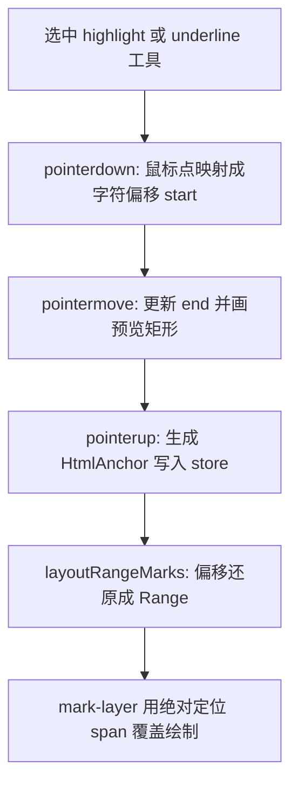

# Vue 试卷：高亮 / 下划线是怎么做的

一句话结论：**不改试卷文字 DOM**，只把「选了哪段字」存成字符偏移（`HtmlAnchor`），再用绝对定位的半透明块盖在文字上画出高亮/下划线。

## 相关文件

| 文件 | 作用 |
|------|------|
| `components/surfaces/VuePaperSurface.vue` | 入口壳：内容层 + 覆盖层绘制 |
| `useHtmlAnnotationStage.ts` | 交互（按下/拖动/松手）与布局重算 |
| `htmlRange.ts` | 文本偏移 ↔ Range ↔ 鼠标点 换算 |
| `useAnnotationStore.ts` | `addHighlight` / `addUnderline` 落库 |
| `types.ts` | `HtmlAnchor`、`HighlightAnnotation`、`UnderlineAnnotation` |



---

## 第 0 步：页面上有两层

在 `VuePaperSurface.vue` 里：

1. **内容层** `contentRef`：真正的 Vue 试卷（`PaperMarkingView`），只负责显示题目文字。
2. **覆盖层** `overlay-root` / `mark-layer`：叠在试卷上，专门画高亮块、下划线、笔迹、图章等。

高亮/下划线最终就是 `mark-layer` 里一堆 `<span class="highlight|underline">`，用 `left/top/width/height` 贴在文字位置上：

- 高亮：整段文字矩形，`opacity: 0.35`
- 下划线：同一矩形底部高度约 `2px` 的细条

**不是**给选中文字包一层 `<mark>` / `text-decoration`。

```vue
<div ref="contentBoxRef" class="content-shell">
  <div ref="contentRef" class="content" contenteditable="false">
    <PaperMarkingView ... />
  </div>

  <div class="overlay-root">
    <div class="mark-layer">
      <span v-for="rect in highlightRects" class="highlight" :style="..." />
      <span v-for="rect in underlineRects" class="underline" :style="..." />
      <span v-for="rect in previewRects" class="... is-preview" :style="..." />
    </div>
  </div>
</div>
```

| 层 | ref | 干什么 |
|----|-----|--------|
| 内容层 | `contentRef` | 真正的 Vue 试卷文字 |
| 坐标盒子 | `contentBoxRef` | 量宽高、把屏幕坐标换成相对像素 |
| 覆盖层 | `mark-layer` | 用绝对定位 `<span>` 画高亮 / 下划线 / 预览 |

---

## 第 1 步：先理解「字符偏移」是什么

试卷 DOM 里文字分散在很多 Text 节点里。`htmlRange.ts` 用 `TreeWalker` 按文档顺序把所有文本节点拼成一条虚拟长字符串：

```text
节点A "题目" + 节点B "答案是" + 节点C "42"
虚拟串: "题目答案是42"
偏移:    0 1 2 3 4 5 6 7
```

持久化结构是 `HtmlAnchor`：

```ts
{ start: number, end: number, quote: string }
```

- `start` / `end`：在这条虚拟串上的起止字符下标
- `quote`：选中文本前 40 字，方便评论区展示

三个核心函数（都在 `htmlRange.ts`）：

| 函数 | 作用 |
|------|------|
| `caretOffsetFromPoint(root, x, y)` | 鼠标屏幕坐标 → 虚拟串上的一个整数偏移 |
| `offsetToRange(root, start, end)` | 虚拟串偏移 → 浏览器原生 `Range` |
| `rangeToOffsets(root, range)` | 原生 `Range` → `{ start, end, quote }` |

### 1. 收集所有文本节点

```ts
export function textNodes(root: Node): Text[] {
  const nodes: Text[] = []
  const walker = document.createTreeWalker(root, NodeFilter.SHOW_TEXT)
  let current = walker.nextNode()
  while (current) {
    nodes.push(current as Text)
    current = walker.nextNode()
  }
  return nodes
}
```

### 2. 鼠标点 → 全局偏移（`caretOffsetFromPoint`）

内部先调浏览器的 `caretRangeFromPoint` / `caretPositionFromPoint` 找到「点在哪个 Text 节点的第几个字符」，再累加前面节点长度，得到全局偏移。

### 3. 偏移 → 浏览器 `Range`（`offsetToRange`）

从左扫 Text 节点，找到 `start`/`end` 落在哪两个节点的哪个字符上，再 `range.setStart` / `setEnd`。

### 4. `Range` → 再存回偏移（`rangeToOffsets`）

松手时把原生 Range 转成 `{ start, end, quote }`。

---

## 第 2 步：按下鼠标 —— 开始划选

工具为 `highlight` 或 `underline` 时，`onPointerDown`（`useHtmlAnnotationStage.ts`）：

1. 用 `caretOffsetFromPoint(contentRef, clientX, clientY)` 得到起点偏移
2. 设 `drawingRange = true`，`draftStart = draftEnd = offset`
3. `setPointerCapture`：鼠标移出试卷区域也能继续收到 move/up
4. `preventDefault`：避免浏览器原生选区干扰（stage 上也有 `user-select: none`）

此时还没有写入 store，只是进入「正在划」状态。

```ts
if (tool === 'highlight' || tool === 'underline') {
  const offset = caretOffsetFromPoint(root, event.clientX, event.clientY)
  if (offset == null) return
  drawingRange.value = true
  draftStart.value = offset
  draftEnd.value = offset
  previewRects.value = []
  stageRef.value?.setPointerCapture(event.pointerId)
  event.preventDefault()
}
```

---

## 第 3 步：拖动 —— 实时预览

`onPointerMove`：

1. 再次 `caretOffsetFromPoint` 得到当前偏移，写入 `draftEnd`
2. 调用 `updatePreview(draftStart, draftEnd, color)`

`updatePreview` 做的事：

1. `offsetToRange` 还原成 `Range`
2. `range.getClientRects()`：一段文字可能折行，所以返回**多个**矩形
3. 每个矩形用 `stageRelativeFromClientRect(contentBox, rect)` 换成相对内容区的像素 `left/top/width/height`
4. 高亮用整高；下划线用 `top + height - 2`、`height: 2`
5. 结果写入 `previewRects`，模板里渲染带 `is-preview` 的临时 span

所以拖的时候看到的是「预览层」，还没存进批注列表。

---

## 第 4 步：松手 —— 落库

`onPointerUp` → `finishRangeMark()`：

1. `start/end = min/max(draftStart, draftEnd)`（支持从右往左拖）
2. 长度 `< 1` 直接丢弃
3. `offsetToRange` → `rangeToOffsets` 得到稳定的 `HtmlAnchor`
4. 调 store：
   - 高亮：`store.addHighlight({ htmlAnchor, color: highlightColor, comment: '' })`
   - 下划线：`store.addUnderline({ htmlAnchor, color: '#ef4444', comment: '' })`

store 只存 **偏移 + 颜色 + 评论**，**不存像素坐标**。像素会在下一步按当前排版重新算。

---

## 第 5 步：重算布局并真正画出来

`watch` 到 `store.highlights / underlines` 变化后，`nextTick` 再 `layoutAll()` → `layoutRangeMarks`：

对每条批注：

1. `offsetToRange(root, htmlAnchor.start, htmlAnchor.end)`
2. `getClientRects()` 得到各行矩形
3. 转成相对 `contentBox` 的像素
4. 高亮：整矩形；下划线：底部 2px
5. 写入 `highlightRects` / `underlineRects`

模板 `v-for` 把这些 rect 画成绝对定位 span。

滚动 / 窗口缩放也会触发 `layoutAll()`，因为 `getClientRects` 是相对视口的，需要重新换算。

```ts
if (mode === 'underline') {
  next.push({
    top: rel.top + rel.height - 2, // 贴在底部
    height: 2,                      // 细线
    ...
  })
} else {
  next.push({
    top: rel.top,                   // 整段字高
    height: rel.height,
    ...
  })
}
```

---

## 高亮 vs 下划线：差异其实很小

| 点 | 高亮 | 下划线 |
|----|------|--------|
| 交互 | 完全相同（划选偏移） | 相同 |
| 存储 | `kind: 'highlight'` + 可选多色 | `kind: 'underline'` + 默认红 |
| 绘制 | 覆盖整段文字高度，半透明 | 只画底部 2px 细线 |
| 预览 | 同上逻辑 | 同上逻辑 |

难点不在两种工具的分支，而在 **「字符偏移 ↔ Range ↔ 多行矩形」** 这套换算。

---

## 为什么依赖「文本节点稳定」

底部 hint 写的「划词依赖文本节点稳定」含义是：

- 锚定靠「第 N 个字符」
- 若 Vue 重渲染导致文本节点拆分/合并或文字插入删除，同一 `start/end` 可能指到别的字
- 所以内容用只读展示（`contenteditable="false"`），并尽量保持试卷 DOM 文本顺序稳定

---

## 建议对照代码时的阅读顺序

1. `VuePaperSurface.vue` 模板里 `highlightRects` / `underlineRects` / `previewRects`
2. `onPointerDown` / `onPointerMove` / `finishRangeMark`（交互）
3. `textNodes` → `caretOffsetFromPoint` → `offsetToRange` → `rangeToOffsets`（换算）
4. `layoutRangeMarks` + `updatePreview`（怎么变成方块）
5. `addHighlight` / `addUnderline`（存什么数据）
